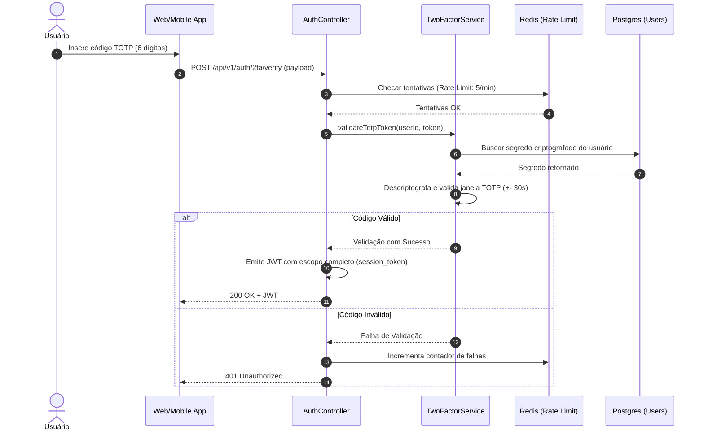

# 📄 Módulo de Autenticação Multifator (2FA)

> **Status**: Implementado  
> **Responsável**: Time de Segurança & Core  
> **Última Atualização**: 2026-10-09  
> **Caminho do Código**: `src/modules/auth/two_factor_service.ts`  

---

## 1. Resumo Executivo
O módulo de Autenticação Multifator (2FA) implementa o protocolo TOTP (RFC 6238) para validação de identidade em duas etapas no login e em ações críticas, mitigando ataques de sequestro de credenciais através de senhas temporárias de 6 dígitos geradas por aplicativos autenticadores.

---

## 2. Arquitetura & Fluxo de Execução



---

## 3. Contratos de Dados & Interfaces

### 3.1. Entrada: `POST /api/v1/auth/2fa/verify`

| Campo | Tipo de Dado | Obrigatório? | Descrição / Exemplo |
| :--- | :--- | :--- | :--- |
| `user_id` | `UUID` | Sim | Identificador do usuário em fase de autenticação temporária. Ex: `e3b0c442-98fc-1c14-9af0-2a3b9566963e` |
| `totp_code` | `string` | Sim | Código de 6 dígitos numéricos emitido pelo app autenticador. Ex: `"482910"` |
| `trust_device` | `boolean` | Não | Se `true`, dispensa 2FA neste dispositivo por 30 dias. Padrão: `false` |

### 3.2. Saída de Sucesso (`200 OK`)

```json
{
  "sucesso": true,
  "dados": {
    "access_token": "eyJhbGciOiJIUzI1NiIsInR5cCI6IkpXVCJ9...",
    "token_type": "Bearer",
    "expires_in": 3600,
    "user": {
      "id": "e3b0c442-98fc-1c14-9af0-2a3b9566963e",
      "two_factor_enabled": true
    }
  }
}
```

---

## 4. Cenários de Falha e Tratamento de Exceções

| Código HTTP | Motivo / Gatilho | Resposta JSON Esperada | Ação Recomendada |
| :--- | :--- | :--- | :--- |
| `400 Bad Request` | Código TOTP diferente de 6 dígitos ou não numérico. | `{"erro": "INVALID_FORMAT", "mensagem": "O código TOTP deve ter exatamente 6 dígitos numéricos."}` | Revalidar máscara de input no frontend. |
| `401 Unauthorized` | Código expirado ou incorreto. | `{"erro": "INVALID_TOTP_CODE", "mensagem": "Código inválido ou expirado."}` | Solicitar novo código ao usuário. |
| `429 Too Many Requests` | Mais de 5 tentativas inválidas em menos de 1 minuto. | `{"erro": "RATE_LIMIT_EXCEEDED", "mensagem": "Muitas tentativas. Bloqueado por 5 minutos."}` | Bloquear envio e exibir cronômetro no cliente. |
| `500 Internal Error` | Falha ao descriptografar chave secreta no KMS/Vault. | `{"erro": "CRYPTO_FAILURE", "mensagem": "Erro interno ao processar credenciais."}` | Notificar time de infraestrutura/on-call. |

---

## 5. Regras de Negócio e Invariantes
1. **Janela de Tolerância**: O cálculo de hash TOTP aceita uma deriva de relógio (clock drift) de no máximo 1 intervalo anterior e 1 posterior ($\pm 30\text{ segundos}$).
2. **Proteção Anti-Replay**: Códigos já consumidos com sucesso dentro da mesma janela de tempo não podem ser reutilizados (gravação de nonce no Redis com TTL de 90s).
3. **Criptografia do Segredo**: O segredo TOTP é armazenado no PostgreSQL utilizando criptografia em repouso AES-256-GCM.

---

## 6. Checklist de Testes e Validação
- [x] Validação com código correto dentro da janela temporal atual.
- [x] Rejeição de código expirado (> 60 segundos).
- [x] Bloqueio e retorno 429 após 5 falhas consecutivas.
- [x] Teste de tentativa de reutilização de código (ataque de replay).
- [x] Latência de verificação inferior a 120ms (Redis + Postgres).
