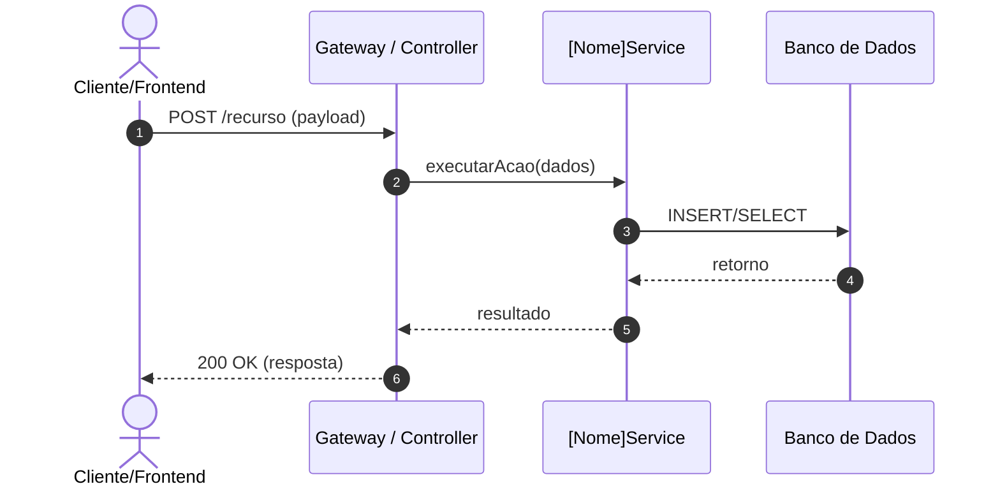

# 📄 [NOME DO MÓDULO / FUNCIONALIDADE]

> **Status**: [Proposto | Aprovado | Implementado | Depreciado]  
> **Responsável**: [Equipe / Desenvolvedor]  
> **Última Atualização**: [AAAA-MM-DD]  
> **Caminho do Código**: `src/[caminho/do/modulo]`  

---

## 1. Resumo Executivo
*Descrição concisa em um único parágrafo explicando o propósito do módulo, a dor que resolve e o contexto no sistema.*

---

## 2. Arquitetura & Fluxo de Execução
*Apresentação do fluxo com diagrama Mermaid (sequenceDiagram ou flowchart TD).*



---

## 3. Contratos de Dados & Interfaces

### 3.1. Entrada (Request / Parâmetros)
| Campo | Tipo de Dado | Obrigatório? | Descrição / Exemplo |
| :--- | :--- | :--- | :--- |
| `id` | `UUID` | Sim | Identificador único do recurso. Ex: `123e4567-e89b-12d3-a456-426614174000` |
| `nome` | `string` | Sim | Nome completo (mínimo 3, máximo 100 caracteres). |
| `ativo` | `boolean` | Não | Status de ativação. Padrão: `true`. |

### 3.2. Saída (Response de Sucesso)
*Código HTTP*: `200 OK` ou `201 Created`

```json
{
  "sucesso": true,
  "dados": {
    "id": "123e4567-e89b-12d3-a456-426614174000",
    "nome": "Exemplo",
    "criado_em": "2026-10-09T10:00:00Z"
  }
}
```

---

## 4. Cenários de Falha e Tratamento de Exceções

| Código HTTP | Motivo / Gatilho | Resposta JSON Esperada | Ação Recomendada |
| :--- | :--- | :--- | :--- |
| `400 Bad Request` | Payload malformatado ou campos inválidos. | `{"erro": "VALIDATION_ERROR", "mensagem": "Nome é obrigatório"}` | Corrigir parâmetros enviados. |
| `401 Unauthorized` | Token JWT ausente ou expirado. | `{"erro": "UNAUTHORIZED", "mensagem": "Token inválido"}` | Renovar autenticação. |
| `404 Not Found` | Recurso não localizado pelo ID. | `{"erro": "NOT_FOUND", "mensagem": "Recurso não encontrado"}` | Verificar identificador. |

---

## 5. Regras de Negócio e Invariantes
1. **Regra 1**: [Descrever a validação de domínio ou regra estrita].
2. **Regra 2**: [Descrever comportamento idempotente ou restrição de concorrência].
3. **Regra 3**: [Descrever política de auditoria/logs].

---

## 6. Checklist de Testes e Validação
- [ ] Teste unitário para o caminho de sucesso (Happy path).
- [ ] Teste unitário para falha com payload incompleto.
- [ ] Teste de integração com banco de dados.
- [ ] Validação de performance (< 200ms sob carga normal).
